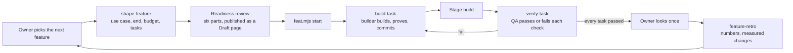

# claude-team-workflow

A kit for running a small team of Claude Code sessions like a delivery team, for one owner.

- **Roles:** a lead, a builder, QA and an optional design session, each a Claude Code session on the same repository.
  The owner picks what is built and looks once at each finished feature.
- **Fixed-time features:** each feature has a use case, an end a person can see, and a time budget that is never
  extended; scope is cut to fit. Tasks are at most a day.
- **Checks only QA can pass:** every task has one to three done-when checks that start failing and are passed only by
  QA, on the published stage build, never by the session that built it.
- **A readiness review before a start:** six parts, each with evidence, so tasks are found before the build, not in it.
- **A retrospective after each feature:** one or two changes, each with a measure, checked on the next feature.

It was built over about ten days in a real project, from the owner's own answers; each rule's reason is in
[docs/decisions.md](docs/decisions.md).

## The loop



## What is in it

```
README.md                 this page
CLAUDE.md.template        the note-keeping skeleton for a project's CLAUDE.md
team-workflow.example.json  the kit's settings, every key optional
MANIFEST.md               every file of the kit and what it is for
.claude/
  rules/workflow.md       the workflow's rules in force
  rule-history/           replaced decisions and long accounts (empty)
  skills/                 the procedures, one folder each:
    shape-feature/          the lead shapes a feature and runs the readiness review
    build-task/             the builder takes, builds and proves the next task
    verify-task/            QA passes or fails a built task on the stage build
    feature-retro/          the retrospective after a feature
    high-stakes-review/     one strong-model review of a costly-to-get-wrong change
    fresh-review/           a reviewer with no history judges a result before the owner
    helper-round/           the brief for a helper, with the standing rules
    heavy-job/              long jobs through one capped list
    record-decision/        the owner's decision into the rule files, safely
docs/
  method.md               the delivery method and why each part is there
  team.md                 roles, messages between sessions, the board, hand-overs, the computer in turns, hooks
  lead.md                 the lead's first hour and hourly check
  decisions.md            the owner's decisions on the workflow, in date order, with the words
  lessons.md              what cost time once, and the rule each left
  adopting.md             adopting the kit, step by step
  stage-live.md           the stage and live builds
templates/                work inventory, board day, hand-over, readiness review, retrospective, carry-over
tools/
  feat.mjs                the delivery list: features, tasks, roles, pauses, retrospectives (hash-chained record)
  hook.mjs                the delivery hooks (session start note, post-tool notes); install-hooks.mjs installs them
  jobs.mjs                the job list with a cap
  notes.py                writes notes into several files only after checking every anchor
  metrics.py              weekly, daily and hourly numbers for a dashboard
  cost/                   per-turn usage numbers from the transcripts, and a window over them
  config.mjs              reads team-workflow.json
  selftest.mjs            runs every selftest (npm test)
```

## Adopting it in a project

1. Copy `.claude/`, `tools/`, `docs/`, `templates/` and `package.json` into the project's root, and
   `CLAUDE.md.template` as `CLAUDE.md`.
2. Copy `team-workflow.example.json` to `team-workflow.json` and change what differs; add `build/` to `.gitignore`.
3. Run `npm test`: every selftest must pass (Node 20+, Python 3.9+).
4. Fill in CLAUDE.md's placeholders: the product, the owner's goals, the target device sizes, the stage and live
   addresses, the checks before a stage publish.
5. Open three or four sessions; in each, `node tools/feat.mjs join <lead|builder|qa|design>`.
6. With the owner's word, install the hooks: `node tools/install-hooks.mjs --settings .claude/settings.local.json
   --owner-word "<words>" --date <YYYY-MM-DD>`.
7. The lead runs `/shape-feature` for the first feature.

The whole: [docs/adopting.md](docs/adopting.md).

## Requirements and limits
- Claude Code, git, Node 20 or later, Python 3.9 or later. Windows, macOS or Linux; the computer-off pause reads the
  Windows power log (elsewhere use the idle pause).
- Messages between sessions use what the host offers (`ListAgents`, `SendMessage`); without them, the board and the
  hand-over files carry the team's state.
- The kit does not judge whether a feature is worth building, and programs do not judge the look: a person and a fresh
  reviewer do.

## Credits
The build-task, verify-task and high-stakes-review skills adapt parts of
[obra/superpowers](https://github.com/obra/superpowers) (MIT, Copyright (c) 2025 Jesse Vincent). The method draws on
Basecamp's Shape Up, Anthropic's writing on harnesses for long-running agents, and Kanban.

## Licence
MIT; see [LICENSE](LICENSE).
