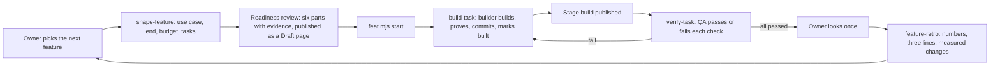

# The delivery method, and why

A small team of Claude Code sessions builds one product for one owner. This page says how the work moves and why each
part is there. The rules in force are in `.claude/rules/workflow.md`; the steps are in the skills.

## The problem it answers

Before this method, in the project the kit comes from, the team kept a list of "pieces" with no clear end. In its first
four days 290 pieces were added and 100 done, 47 dropped, and 148 questions were put to the owner; on every single day
more pieces were added than finished. Most of the time went into small adjustments. The owner: "We need to break the
work down to work tasks with a clear usecase and description, right now we have features without a clear ending, and
alot of work is just small adjustments that takes alot of time. The issue is that we do not focus and we dont use any
form of burndown or way to measure wether we finish any features."

## Its parts and where each comes from

| Part | From | Why |
|---|---|---|
| A feature has a fixed time budget; scope is cut to fit, the budget is never extended | Shape Up (Basecamp): appetite, fixed time and variable scope | Without a fixed end, work grows to fill any time; a budget forces the choice of what matters |
| Tasks of at most a day, each with a use case, the screens, the user's steps and one to three done-when checks | Anthropic's harness for long-running agents: a list of checks that start failing | An agent left to judge "done" calls it done early; a check that starts false and is seen by someone else does not |
| Only QA passes a task, on the published stage build | The same harness, and the usual split between building and acceptance | A builder's report is not evidence; the build the owner opens is the one that counts |
| One feature in build at a time | Kanban's limit on work in progress | Several features at once means none finishes; the burnup shows whether one does |
| Done in two levels: tasks by QA, the feature by the owner's one look | Scrum's definition of done, cut to what a team of agents can hold | The owner looks once per feature, not at every task |
| A readiness review before the start, with evidence for each part | The first feature: 52 of its 67 tasks were found during the build | Unknowns are cheapest before the start; the owner asked for "evidence based desicions BEFORE development starts" |
| A retrospective after every feature, with one or two measured changes | The owner: "self improvement are very important so we need that to be a part of the flow" | A change that is not measured is not known to help; more than two at once cannot be told apart |
| Stage and live builds | Ordinary release practice | The team publishes to stage freely; live takes only the stage build, on the owner's word |
| A hash-chained record written by one tool | The need to trust the numbers the retrospective reads | A hand edit to the record is caught and undone |

## The loop

## What "done" is not
- "The tests pass." Tests are the builder's tools; a done-when is something a person sees on the stage build.
- "Better" or "tuned." A done-when is a thing that happens on screen, at the target device sizes.
- The maker's own verdict. Someone other than the author reads it first.

## The numbers the team keeps
From `node tools/feat.mjs status` and `tools/metrics.py`, never estimated:
- budget against hours worked (pauses left out) and the burnup of tasks passed;
- tasks at the start, added after (misses of the readiness review), cut;
- QA's fails per task, and hours from built to passed;
- cost per feature in token units (input 1, cache write 1.25, cache read 0.1, output 5) from the transcripts' usage
  numbers only.

## What it cannot do
- It cannot tell whether a feature is worth building: the owner picks.
- Checks a program can run do not cover the look. The look is judged by a person and a fresh reviewer against
  references (the skill `fresh-review`).
- Sessions cannot clear themselves or press keys in each other's tabs; a hand-over file and the owner do that.
